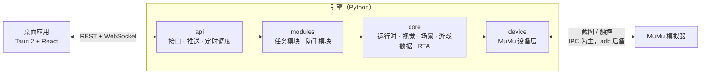

<div align="center">


# 第七史诗助手（e7helper-neo）

第七史诗**国服（简体中文）**、**MuMu 模拟器**专用的桌面助手

An unofficial desktop assistant for Epic Seven (China server) on MuMu Player.

[](LICENSE)


[下载](https://github.com/Jiyan-Chen/e7helper-neo/releases) · [功能](#功能) · [快速开始](#快速开始) · [从源码构建](#从源码构建) · [架构文档](docs/architecture.md)

</div>

---

## 简介

第七史诗助手是一款面向第七史诗国服玩家的 Windows 桌面应用，提供日常任务自动化和 RTA（世界竞技场实时对战）选秀辅助。

- **只操作画面**：通过截图识别游戏画面、模拟触控完成操作，不修改游戏客户端，不读写游戏内存，也不拦截网络数据。
- **模块化**：每项功能都是独立模块，引擎启动时自动发现；新增功能不需要改动框架代码。
- **离线可测**：任务逻辑可以在用真实截图搭建的模拟环境中离线测试，误触消耗资源的按钮会直接判为失败。
- **面向玩家**：图形界面开箱即用，安装包内置运行环境，无需另装 Python。

## 功能

| 功能 | 说明 | 正式版 | 测试版 |
|---|---|:---:|:---:|
| 日常收取 | 邮件（只领取快过期的）、精灵之森、誓约免费召唤、商店每日 / 每周限购商品、竞技场 NPC（可用友情点数补充旗帜） | ✓ | ✓ |
| 书签刷取 | 刷新神秘商店，购买誓约书签、神秘奖牌、友情点数；可设刷新次数、连续未出现时停止或更换世界频道；附刷取历史统计 | ✓ | ✓ |
| 重复刷关 | 托管战斗自动结算与重开、手动刷讨伐；支持讨伐异界，可用生命之叶或天空石补充 | ✓ | ✓ |
| 我的流程 | 采集自己的画面模板，用「步骤 + 条件分支」编排流程，像内置功能一样运行和定时 | ✓ | ✓ |
| 计划 | 按每天固定时刻或固定间隔自动启动任务 | ✓ | ✓ |
| 断线自动重进 | 遇到连接中断、登录公告、标题画面时自动重新进入大厅 | ✓ | ✓ |
| 英雄图鉴 | 全部英雄的属性、职业、技能、专属装备、角色奉献和配装统计，支持联网更新 | ✓ | ✓ |
| RTA 助手 | 选秀全程辅助：每一手的推荐与预期胜率、预禁推荐、后禁矩阵、先动概率、个人英雄池 | — | ✓ |

> [!NOTE]
> RTA 助手仍在测试中，目前需要手动录入双方的选人，自动识别画面尚在规划中。

## 版本说明

自 0.3.0 起，每次发布分为两种安装包，均可在 [Releases](https://github.com/Jiyan-Chen/e7helper-neo/releases) 下载：

| 版本 | 说明 | GitHub 标记 |
|---|---|---|
| 正式版 | 日常自动化与英雄图鉴，功能稳定 | Latest |
| 测试版 | 正式版全部功能，另含测试中的 RTA 助手 | Pre-release |

两种版本安装在同一位置，后安装的会替换先安装的；设置和记录保存在 `%LOCALAPPDATA%\e7helper`，两种版本共用，覆盖安装或切换版本都不会丢失。

## 系统要求

- Windows 10 / 11（64 位）
- [MuMu 模拟器 12](https://mumu.163.com/)，分辨率设为 **1600×900**（平板模式）
- 第七史诗国服（简体中文）客户端

## 快速开始

1. 在 MuMu 模拟器中安装并登录第七史诗国服。
2. 从 [Releases](https://github.com/Jiyan-Chen/e7helper-neo/releases) 下载 `e7helper_<版本>_x64-setup.exe` 并安装，可选择「仅为我安装」或「为所有用户安装」。
3. 启动「第七史诗助手」，应用会自动连接正在运行的 MuMu 实例；需要更换实例时在「设置」中切换。
4. 在左侧菜单选择功能，调整设置后点击「开始」；需要定时运行时在「计划」中添加。

> [!TIP]
> 安装包没有数字签名。Windows 提示「未知发布者」时，点击「更多信息」→「仍要运行」即可。每个版本的发布说明中附有安装包的 SHA256，可用于校验。

## 从源码构建

### 技术栈

| 部分 | 技术 |
|---|---|
| 引擎 `engine/` | Python 3.12+、uv、OpenCV、RapidOCR、ONNX Runtime、FastAPI |
| 桌面应用 `app/` | Tauri 2（Rust）、React 19、TypeScript、Vite、Tailwind CSS |
| 打包 | PyInstaller（引擎冻结）、NSIS（安装包） |

### 环境准备

| 工具 | 要求 | 开发环境实测版本 |
|---|---|---|
| Python | 3.12 及以上，64 位 | 3.13 |
| [uv](https://docs.astral.sh/uv/) | — | — |
| Node.js、pnpm | — | Node 24、pnpm 12 |
| Rust | 1.90 及以上，MSVC 工具链 | 1.97 |
| MuMu 模拟器 12 | 运行引擎和真机测试时需要 | — |

> [!NOTE]
> `engine/pyproject.toml` 将华为云 PyPI 镜像设为默认索引，`uv.lock` 也锁定在该镜像。所在网络访问该镜像较慢时，可以设置环境变量 `UV_DEFAULT_INDEX` 改用其他索引。

### 引擎

```bash
cd engine
python -m uv sync                      # 安装依赖
python -m uv run pytest                # 单元测试（不需要模拟器）
python -m uv run e7helper doctor       # 检查 MuMu 安装与连接
python -m uv run e7helper modules      # 列出已发现的模块
python -m uv run e7helper run daily    # 运行模块（默认演练，只识别不消耗资源）
```

真机测试需要 MuMu 正在运行，设置环境变量 `E7_DEVICE_TESTS=1` 后执行 `python -m uv run pytest -m device`。

### 桌面应用

```bash
cd app
pnpm install
pnpm tauri dev      # 开发版；没有正在运行的引擎时会自动用 engine/.venv 拉起
pnpm test           # 前端测试
pnpm typecheck      # 类型检查
```

开发版会额外显示演练开关、模板采集等开发者功能。不想连接模拟器时，可设置 `E7_ENGINE_ARGS="--no-connect --paused"`。

### 打包

```bash
cd engine
python -m uv run --group build python packaging/build.py            # 冻结引擎并冒烟测试（测试版）
python -m uv run --group build python packaging/build.py --no-rta   # 不带 RTA 的正式版
cd ../app
pnpm bundle                                                         # 生成 NSIS 安装包
```

安装包输出在 `app/src-tauri/target/release/bundle/nsis/`。发版流程详见 [架构文档 · 打包发布](docs/architecture.md#打包发布b10)。

## 架构



- 依赖方向自上而下：`modules → core → device`，上层只依赖 `Device` 抽象。
- 模板、坐标和区域统一按 **1600×900** 基准记录，运行时按实际分辨率换算。
- 模块分两类：**任务模块**（`TaskModule`）会点击游戏，同一时间只运行一个；**助手模块**（`AssistantModule`）只读取画面，可以并行。

### 目录结构

```text
e7helper-neo/
├── engine/                 引擎（Python）
│   ├── e7helper/
│   │   ├── device/         MuMu 设备层：IPC 截图与触控，adb 后备
│   │   ├── core/           运行时、视觉（模板匹配 / OCR）、场景与弹窗、事件、游戏数据、RTA
│   │   ├── modules/        功能模块，启动时自动发现
│   │   ├── api/            REST / WebSocket 接口与定时调度
│   │   └── cli.py          命令行入口
│   ├── assets/             画面模板与随包数据
│   ├── tests/              单元测试与离线模拟器
│   ├── packaging/          引擎冻结、冒烟测试与版本脚本
│   └── tools/              开发工具
├── app/                    桌面应用
│   ├── src/                前端（React + TypeScript）
│   └── src-tauri/          Rust 外壳：窗口、拉起与管理引擎
└── docs/                   架构、路线图与审核记录
```

### 扩展模块

在 `engine/e7helper/modules/<id>/` 下新建模块，继承 `TaskModule` 或 `AssistantModule`，模板放在 `engine/assets/<id>/cn/`，引擎启动时会自动发现。界面扩展放在 `app/src/modules/<id>/`。完整说明和参考实现见 [架构文档 · 新增一个模块](docs/architecture.md#新增一个模块)。

## 文档

| 文档 | 内容 |
|---|---|
| [docs/architecture.md](docs/architecture.md) | 模块契约、各层职责、接口、打包发布 |
| [docs/ROADMAP.md](docs/ROADMAP.md) | 任务块清单与状态 |
| [docs/HANDOFF.md](docs/HANDOFF.md) | 当前进度与开发注意事项 |
| [docs/reviews/](docs/reviews/) | 各任务块的变更清单、验证记录与已知问题 |

## 路线图

计划中的功能包括 RTA 助手的画面自动识别、站位建议与阵容快速分析，以及装备扫描、GVG 作业查询、兑换码、资源统计等模块。具体安排与进度见 [ROADMAP](docs/ROADMAP.md)。

## 免责声明

- 本项目是玩家自制的非官方工具，与 Smilegate、祖龙娱乐及其关联公司无任何关联，未获得其授权或认可。
- 「第七史诗 / Epic Seven」及相关名称、角色、图像等游戏内容的著作权和商标权归其各自权利人所有。
- 使用自动化工具可能违反游戏用户协议，并可能导致账号受到处罚。**请自行评估风险，使用本软件的一切后果由使用者自行承担。**

## 许可证

本项目的源代码以 [MIT 许可证](LICENSE) 发布。

以下内容不属于本项目原创，**不在 MIT 许可证的授权范围内**，其权利归各自权利人所有：

- 游戏截图，以及从游戏截图中裁取的画面模板、图标和背景图（如 `engine/assets/*/cn/`、`engine/tests/fixtures/`、`app/src/assets/`、`docs/` 中的截图）；
- 英雄头像（包括应用图标所用的头像）、技能与装备图标等游戏美术资源；
- 来自第三方站点的英雄资料（`engine/assets/data/heroes/`），使用时请遵守其来源的许可与使用条款；
- 项目依赖的第三方软件，分别适用其各自的许可证。

## 致谢

- [Fribbels Epic 7 Optimizer](https://github.com/fribbels/Fribbels-Epic-7-Optimizer)：英雄基础数据与配装统计
- [e7.wiki](https://e7.wiki/)：英雄中文资料
- [e7rtabot](https://e7rtabot.com/)：RTA 助手的交互参考
- [RapidOCR](https://github.com/RapidAI/RapidOCR)、[ONNX Runtime](https://onnxruntime.ai/)、[Tauri](https://tauri.app/) 等开源项目
