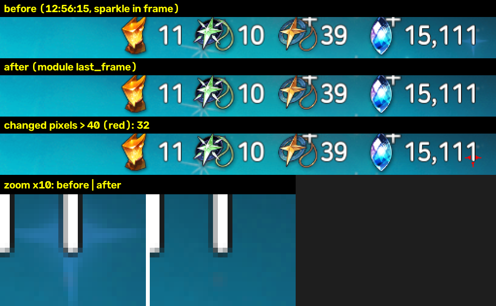

# B07 审核记录：日常收取（邮件 / 精灵之森 / 誓约免费召唤）

状态：✅ 已通过 · 日期：2026-10-17（10-18 补测完整召唤流程，同日审核通过）

## 范围（开工时和用户确认）
- 只做三项：
  - **邮件**：只领剩余时间一天以内的；
  - **圣域 → 精灵之森**：领取产出；用户在开发中补充「有照料就做，照料不花资源」；
  - **誓约召唤的免费召唤**：用户选方案 A，按钮显示「免费」就点，优先免费十连，一直点到用完。
- 不做：
  - 派遣（已改成轮换活动）；
  - 骑士团捐献 / 签到（骑士团即将大改版）；
  - 友情召唤（现版本已移除）；
  - 每日任务、成就、通行券。
- 欧勒毕斯之心、炼金术师之塔没有每天免费的东西，不进去。
- **每日重置**：服务器时间 GMT-7 中午 12 点 = UTC 19:00 = 北京时间凌晨 3 点（用户确认）。
- 模块拆分：一个 TaskModule `daily`，三项各一个开关。理由同 B06：任务互斥，一次运行要做的事放在同一个模块里；B08 定时调度每天启动一次即可。

## 交付内容
| 文件 | 说明 |
|---|---|
| `engine/e7helper/modules/daily/__init__.py` | `DailyModule`（id `daily`）。按 邮件 → 精灵之森 → 誓约召唤 的顺序做，每项前后都回到大厅。`setup()` 注册 7 个场景（`daily_mail` / `daily_forest` / `daily_covenant` / `daily_summon` / `daily_summon_anim` / `daily_summon_hero` / `daily_summon_results`）和 2 个弹窗（`daily_forest_reward` 点「点击关闭」；`daily_mail_detail` 自动关闭时点「点击关闭」，不收信） |
| `engine/e7helper/modules/daily/page.py` | 纯函数识别：<br>• 邮件：`scan_mail`（以每行「领取」为锚点 OCR 剩余时间）、`parse_remaining`、`read_mail_count`、`read_mail_detail_remaining`<br>• 精灵之森：`read_forest`（三张卡可领 / 倒计时，照料次数和倒计时）、`parse_timer`<br>• 誓约召唤：`read_covenant`（两个「免费」按钮 + 剩余免费气泡）、`currency_patch` / `changed_pixels_all`（顶栏货币区域前后各两帧对比） |
| `engine/e7helper/modules/daily/ledger.py` | 按天记账 `ledger.json`：游戏日（北京时间 3 点切换，按 UTC 计算，和本机时区无关）、当天已做完的项、精灵之森下次时间 |
| `engine/e7helper/modules/daily/config.py` | `DailyConfig` |
| `engine/e7helper/modules/daily/stats.py` | `history.jsonl`、`stats.json` |
| `engine/assets/common/cn/` | `lobby/sanctuary`（带 tap）、`lobby/summon`、`top/mail`、`title/mail`、`title/forest`、`title/summon` |
| `engine/assets/daily/cn/` | 18 个模板：<br>• `sanctuary/forest`<br>• `forest/{claim,close,care}`<br>• `mail/{claim,sort_remain,claim_all,receive,detail_close}`<br>• `summon/{tab_covenant,wishlist,free_1,free_10,skip,next,results,back,again}`<br>可点的「领取」「领取奖励」「免费」「收信」「返回」都设了 `max_diff 30`；`claim_all`、`again` 只用来认界面，绝不点 |
| `engine/tests/fixtures/daily_*.png` | 35 张实机截图（53MB，fixtures 总计约 137MB） |
| `engine/tests/daily_sim.py` | 模拟器：大厅、邮件（含详情框）、圣域 / 精灵之森（奖励框淡入淡出）、召唤 / 誓约召唤（十连：动画 → 跳过 → 英雄展示 → 结果；单抽：动画 → 卡片）。以下按钮都是 DANGER：<br>• 「全部领取」<br>• 不是第一行的「领取」<br>• 不免费的召唤按钮<br>• 「再召唤一次」 |
| `engine/tests/test_daily.py` | 43 个测试函数（参数化后 149 个用例） |
| `docs/architecture.md` | 「已有模块」加 `daily` |

### 配置 `DailyConfig`
| 字段 | 默认 | 表单 | 说明 |
|---|---|---|---|
| `mail` / `forest` / `covenant` | true | ✔ | 三项开关 |
| `dry_run` | **true** | ✔ | 只导航和识别 |
| `mail_max_hours` | 24 | | 剩余时间小于这么多小时才领（「剩余1天」按 24 算，不领）。实测时放宽到 168 |
| `mail_max_claims` | 0 | | 每次最多领几封（0 不限），控制实跑规模用 |
| `covenant_max` | 0 | | 每次最多点几次免费召唤（0 用完为止） |
| `force` | false | | 忽略账本 |
| `max_failures` | 3 | | 同一项连续失败几次放弃这一项 |

### 流程与核对
1. **邮件**：大厅顶栏信封 → 邮件列表。
   - 左下角必须显示「剩余时间」（按剩余时间从短到长排序），否则不领。
   - 第一行剩余时间认不出就停。在当前屏找第一封剩余时间小于阈值的，点它自己的「领取」。
   - 有些邮件会先弹出**详情框**（用户提醒；实跑时 GM 的行动力邮件就是这样）：框里的剩余时间和那一行一致才点「收信」，不一致就点「点击关闭」并停止这一项。
   - 每领一封都核对底部邮件数**减少 1**：没变算失败（连续 3 次放弃），减少更多 → 异常，停止。
   - 出现其他弹窗时按规则关闭（确认框点取消），停止这一项。
2. **精灵之森**：大厅「圣域」→「精灵之森」→ 读三张卡（亮蓝色「领取奖励」= 可领；否则 OCR 倒计时）和照料（「照料(n/3)」+ 倒计时）。
   - 领取：点卡片 → 奖励框完全显示 → 点「点击关闭」→ 等框消失 → 核对卡片变回倒计时。
   - 照料：还有次数、没在倒计时就点，核对 n 加 1；没变 → 这一项失败（不重复点）。
   - 结束时按最短的倒计时把「下次时间」记进账本，没到时间不进去。
3. **誓约召唤**：大厅「召唤」→ 左侧「誓约召唤」页签。
   - 要点的按钮：「召唤10次」显示免费就点十连，否则「1次召唤」显示免费就点单抽，两个都不免费就记为当天做完。
   - 召唤过程中只点「跳过」/「下一页」，结果页只点「返回」。
   - 回到誓约页后核对两件事，任一不符 → `DailyAnomaly`，整个任务立即停止：
     - **顶栏货币区域画面不变**：召唤前后各取两帧（间隔 0.6 秒），四对两两比较都变了的像素 ≤ 60 才算没变。背景立绘的星星光效会飘进这块区域，单帧 6–80 个像素，只在一帧里出现；实测排除后召唤前后都是 0，一个数字变化有 5000+；
     - **剩余免费次数正好减少 10 或 1**。
   - 出现确认框 → 点取消并停止；认不出的画面静止 10 秒 → 停止。
4. dry-run：三项都进去识别，记下「会做什么」，不点领取、照料、召唤、收信。

## 实测
### 采集
- 2026-10-16 我点导航截了「重置前」的邮件、圣域、精灵之森（倒计时）、召唤、誓约（免费已用完）。
- 用户告诉我已重置后（10-17 21:23），截了：圣域夜晚背景、精灵之森两张卡可领、誓约「21/21」免费、邮件。
- 录屏 1（用户操作）：领企鹅巢穴、免费十连 1 次、领 1 封签到邮件。
- 录屏 2、3（模块实跑时我录的，用户同意）：邮件详情框、只剩单抽的誓约页、单抽结果卡片、免费用完的誓约页。

### 真机 dry-run
`python -m uv run e7helper run daily -c '{"mail_max_hours": 168}'`，31.8 秒：
```
邮箱 10 封；当前屏：剩余6天，剩余6天，无限制，无限制
邮件：dry-run，下一步会领取「剩余6天」的邮件
精灵之森：企鹅巢穴 9:45:22，精灵之泉 可领，魔罗戈拉种植地 148:09:04；照料：0/3，4:09:04 后
誓约召唤：1次 免费，10次 免费，剩余免费 11/21
```

### 真机实跑（用户同意，各项单独跑）
| 时间 | 配置 | 结果 |
|---|---|---|
| 22:39 | 邮件：`mail_max_hours 168, mail_max_claims 1` | **失败（安全）**：点领取后弹出邮件详情框（「收信」），当时不认识这个框，按遮罩兜底用返回键关掉；连点 3 次都这样，邮件数一直是 10，没有领到任何东西 |
| 22:43 | 同上（加了详情框处理后） | ✔ 详情框剩余「剩余6天」与列表一致 → 收信 → 邮件数 10 → 9，12.4 秒 |
| 22:43 | 精灵之森 | ✔ 领取精灵之泉，卡片变回倒计时；下次 3:45:24 后（照料），20.3 秒 |
| 22:44 | 誓约召唤（用完剩下的 11 次） | 免费十连完成，顶栏没变（10 / 10 / 31 / 15,636），然后**停止（安全）**：只剩 1 次时气泡移到了「1次召唤」上方，没读到，按「剩余次数不符」停止 |
| 22:45 | 同上（气泡两个位置都读之后） | 免费单抽完成，然后**停止（安全）**：单抽的结果是一张卡片，只有「返回」、没有「召唤结果」标题，认不出、静止 10 秒后停止，没有乱点 |
| 22:48 | （我手动点「返回」，只是导航） | 回到誓约页：两个按钮都不免费（5 / 50），顶栏和单抽前逐像素比对**变化 0**，没花任何东西 |
| 22:55 | 全部开、默认配置 | ✔ 邮件没有一天以内的；精灵之森「没到时间（下次 10-18 02:29）」不进去；誓约「免费次数用完」→ 记为当天做完；22.5 秒 |
| 22:55 | 再跑一次 | ✔ 精灵之森、誓约召唤都按账本跳过，2.4 秒 |

- 合计：领邮件 1 封、精灵之森领取 1 次，免费召唤 21 次（用户手动十连 1 次 + 模块十连 1 次 + 单抽 1 次），**没有花任何资源**。
- `stats.json` 里免费召唤是 0：模块的两次召唤都在召唤完成之后、核对阶段停下，没有计入。
- 三个问题都已修复，并补了 fixtures 和测试：
  - 邮件详情框：新增 `daily_mail_detail` 弹窗和「收信」流程；
  - 气泡位置：`read_covenant` 两个位置都读；
  - 单抽结果：结果页场景改为只认左下「返回」。
- 单抽动画没有「跳过」按钮，约 9 秒自己播完；模拟器已按这个改。

### 10-18 补测：修复后的完整召唤流程（用户要求）
重置后（12:55，「免费21次！」）`-c '{"dry_run": false, "mail": false, "forest": false}'`，录屏：
```
12:56:01 誓约召唤：1次 免费，10次 免费，剩余免费 21/21
12:56:03 免费召唤 10 次（剩余免费 21/21；顶栏 11 10 39 15,111）
12:56:13 ✔ 免费召唤 10 次完成，用时 7 秒，剩余免费 11/21，顶栏没变（11 10 39 15,111）
12:56:15 免费召唤 10 次（剩余免费 11/21；顶栏 11 10 39 15,111）
12:56:25 任务结束：failed —— DailyAnomaly：免费召唤后顶栏货币变了（80 个像素；现在 11 10 39 15,111）
```
- **问题 4（误报，安全停止）**：第二次十连完成后顶栏核对报了 80 个像素的变化，但 OCR 读数前后一样。
  - 用录屏逐帧比对：静止的誓约页之间完全一样（0），只有背景立绘的星星光效偶尔飘进顶栏区域右下角（约 x 1174–1192、y 47–64），单帧 6–80 个像素，下一帧就没了。
  - 修复：前后各取两帧（间隔 0.6 秒），两两比较都变了的像素才算（`changed_pixels_all`）。用录屏里的光效帧验证：单帧比较 38 个像素，修复后 0。
  - 补了 4 张 fixtures 和测试，数字真的变化时仍是 5000+。
  - 对比图（红色 = 变化的像素，下方放大 10 倍）：
  - 用户确认**保留**顶栏货币核对（10-18）：正常免费召唤用不到这些货币，剩余免费次数的核对也能抓到点错；但货币核对是唯一能直接证明「没扣东西」的证据（召唤前气泡没读出来、游戏意外扣费时只有它能发现），每次召唤只多约 1.2 秒。

修复后继续（剩余单抽）：
```
12:58:54 誓约召唤：1次 免费，10次 不免费，剩余免费 1/21
12:58:55 免费召唤 1 次（剩余免费 1/21；顶栏 11 10 39 15,111）
12:59:15 ✔ 免费召唤 1 次完成，用时 15 秒，剩余免费 ?，顶栏没变（11 10 39 15,111）
         誓约召唤：免费次数用完（这次召唤 1 次）
12:59:19 任务结束：succeeded（34.2 秒）
```
- 单抽结果卡片（只有「返回」）、只剩单抽时的气泡位置、用完后记账（`ledger.json`：`day 2026-10-18`，`covenant` 已做完）都在真机上通过了。
- 这次用掉的是当天 21 次免费（十连 → 十连 → 单抽），顶栏全程 11 / 10 / 39 / 15,111，**没有花任何资源**。
- 21 次因为中间那次误报分成了两次运行，「一次运行连续做完」在真机上还差一遍（同一段代码，离线模拟已覆盖），要等下次重置。
- 顺便 dry-run 了精灵之森（只导航）：企鹅巢穴可领；照料已经是 1/3（有人在夜里照料过一次），下次 13:53:16 后。「可照料」的样子仍然没见过；补了一张 1/3 的 fixture。

## 验证命令
```
cd engine
python -m uv run pytest tests/test_daily.py -q   # 149 passed（约 6.5 分钟）
python -m uv run pytest -q                       # 648 passed, 7 skipped（约 12.5 分钟）
python -m uv run e7helper run daily              # 真机 dry-run
```

## 已知问题 / 后续
- **照料没有实跑**：可照料时按钮的样子还没见过（10-17 实跑时还要约 4 小时；10-18 再看时已经被照料过一次，1/3，下次 13:53 后）。现在按「还有次数、没有倒计时」判断可照料，点了之后核对次数加 1；不对就记失败、不重复点。下次实跑时请留意，必要时补模板。
- **魔罗戈拉成熟（「领取奖励」）没见过**：按和另外两张卡一样的方式处理（三张卡共用「领取奖励」模板）。休息期（有倒计时、没有照料行）能识别。
- **召唤流程的每一段都在真机上通过了**（10-18：十连、十连、单抽、用完记账），但因为问题 4 的误报，21 次分成了两次运行；「一次运行连续做完」还差一遍，要等下次重置。
- 邮件只看当前一屏：列表按剩余时间排序，快过期的都在最上面，所以不滚动。如果一天以内的邮件超过一屏，领完上面的会自动顶上来，按「领一封、重新扫描」继续。
- 剩余时间的其他写法（「剩余X小时」「X分」）只按格式猜测写了解析和测试，实机没见过：认不出时第一行就停、不领。
- 精灵之森按倒计时决定下次进入时间；如果用户在游戏里自己领了，账本不知道，到时间进去看一眼即可。
- 圣域白天 / 夜晚背景不同，标题模板两种都测过。
- fixtures 新增 42MB（总计约 126MB）。

## 用户审核意见
- 审核通过（2026-10-18），提交并合入 main。
- 范围：只做邮件、圣域（精灵之森）、誓约召唤的免费召唤。派遣已改成轮换活动，骑士团即将大改版，都先不做；友情召唤已移除；每日任务 / 成就 / 通行券先不做。
- 邮件只领剩余时间一天以内的；有些邮件点领取后需要额外确认（详情框「收信」）；测试时可以放宽阈值。
- 精灵之森：欧勒毕斯之心、炼金术师之塔没有每天免费的东西；有照料就做，照料不花资源。
- 誓约免费召唤用方案 A：显示「免费」就点，优先十连，用完为止。
- 每日重置：GMT-7 中午 12 点（= 北京时间凌晨 3 点）。
- 需要录屏时可以由我自行录屏（实跑阶段）。
- 要求在真机上跑一遍修复后的完整召唤流程（10-18 已跑，见上）；顶栏货币核对保留现状。
