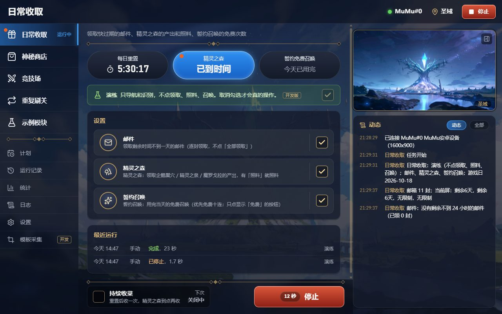
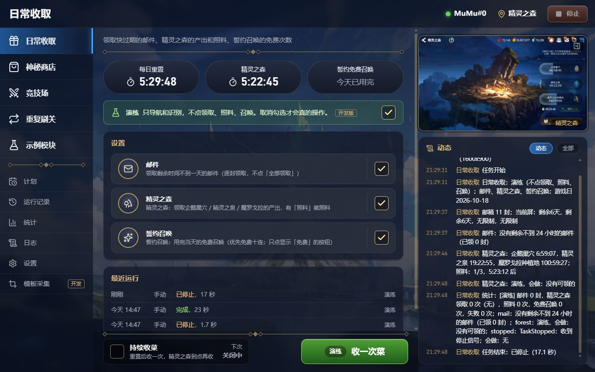
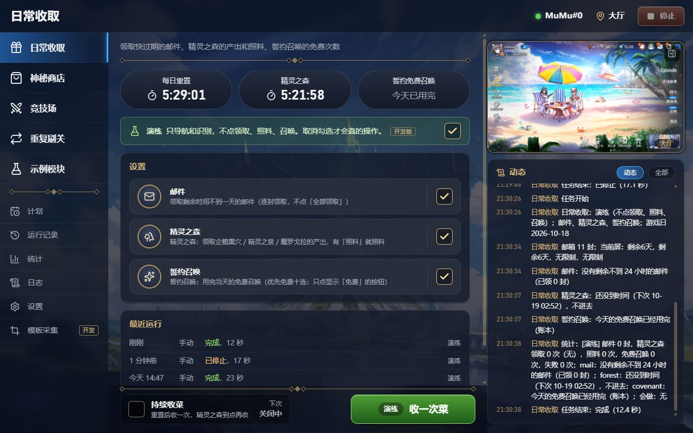

# B09 审核记录：GUI（Tauri 2 + React）

状态：✅ 已通过 · 日期：2026-10-18（同日真机验证并审核通过）

## 开发环境（开工时检查）
| 项 | 版本 / 情况 |
|---|---|
| Node | 24.19.0（npm 11.17.0；直连 npmjs 约 2.5MB/s，不换镜像） |
| pnpm | 12.14.0（`npm i -g pnpm`，用户同意；npm 拦下了它的 install 脚本，`pnpm -v` 和后续使用都正常） |
| Rust | 1.97.1，`stable-x86_64-pc-windows-msvc`；`~/.cargo/config.toml` 已用 rsproxy |
| MSVC | Visual Studio 生成工具 2022（17.14） |
| WebView2 | 155.0.4283.60 |
| Tauri CLI | npm 包 `@tauri-apps/cli` 2.12.3（不 `cargo install`） |
| 主要依赖 | React 19.3、Vite 8.3、Tailwind 4.3、TypeScript 7.0、react-router 8.4、@tanstack/react-query 5、zustand 5、radix-ui 1.8、lucide-react；Rust：tauri 2.12、windows-sys 0.60、getrandom 0.3 |

## 设计风格（用户选定）
- 四套原型在 `docs/prototypes/b09/`（A 工作台、B 星辰书卷、C Windows 原生、D 游戏风）。用户问「有没有更符合第七史诗游戏风格的 GUI」后，我对照 fixtures 截图做了 D，**用户选定 D**。
- D 的部件都取自游戏截图：
  - 深藏青半透明圆角面板、带菱形装饰的米金色分隔线；
  - 左侧菜单照竞技场菜单做，选中项是蓝色辉光；
  - 计时照精灵之森的胶囊按钮做，到时间的发蓝光、带红点；
  - 设置行照邮件列表做，用米金描边的勾选框；
  - 底部行动条照「准备战斗」做，绿色主按钮、古铜次按钮；
  - 橙红角标；数字用系统自带的 Bahnschrift。
- 背景（用户要求）：圣域，取进入圣域时 UI 淡入前的一帧，用 CSS 压暗。
  - 采集方式：游戏原本停在圣域，先点返回回到大厅，再点「圣域」并连拍 5 秒（102 帧），取第 2.57 秒那一帧（没有 UI，镜头已停稳），最后点返回回到大厅。
  - 只点了圣域入口和返回键，没有其他操作。

## 范围（和用户确认）
- **页面**：外壳（顶栏、左侧菜单、右侧可收起的「画面 + 动态」）、各模块页、计划、运行记录、统计、日志、设置、模板采集（开发版）。
- **引擎连接**：先连，连不上再拉起；token 由 Tauri 生成，经 `E7_API_TOKEN` 传入。
- **dry_run**（用户意见）：只在开发调试环境显示演练开关，正式环境不需要。确认的含义是：打包版不显示开关，启动任务和建计划一律 `dry_run=false`；开发版显示开关，默认演练。
- **用户意见**：「最后打包的版本是要面向用户的，不要带入开发者的思维，要用用户思维来进行 GUI 和功能按钮的布局设置。」
- 模块自定义页面按 module id 挂载；自动表单基于 schema；daily 页有计时和单次 / 持续收菜；模板采集的后端接口在 B09 补；时间格式后端不动，前端统一转换。

## 交付内容
### 前端 `app/`
| 文件 | 说明 |
|---|---|
| `src/lib/` | `api.ts`（REST，含模板采集）、`ws.ts`（/ws，断线重连 1→5 秒）、`frames.ts`（帧频道 → object URL）、`store.ts`（zustand；WS 事件更新状态、让 react-query 失效）、`time.ts`（unix 秒 / 带时区 ISO / 不带时区本地 ISO 三种都转 Date）、`schema.ts`（JSON Schema → 字段）、`labels.ts`（场景名、状态、来源、日志中文化）、`run.ts`（正式版强制 `dry_run:false`）、`env.ts`（开发版判断）、`connection.ts` |
| `src/components/shell/` | 启动画面（等引擎就绪、失败可重试）、顶栏（模拟器 / 当前画面 / 下个计划倒计时 / 停止）、左侧菜单（运行中、计划中标记）、右侧实时画面 + 动态（可收起，记在本机）、背景 |
| `src/components/module/` | 通用模块页：说明、计时胶囊、（开发版）演练条、自动表单、最近运行、底部行动条（开始 / 停止，显示用时；没连模拟器或别的任务在跑时按钮上直接写原因） |
| `src/components/ui/` | 装饰线、勾选框、对话框、下拉框、确认框、提示条 |
| `src/pages/` | 计划（列表、立即运行、开关、删除、新建 / 编辑对话框、推荐计划、总开关）、运行记录（按功能筛选，错误只显示最后一行）、统计（各模块累计，中文项名）、日志（动态；开发版可看全部带来源；按级别和关键字筛选）、设置（模拟器连接 / 断开 / 切换实例、版本）、模板采集（开发版） |
| `src/modules/<id>/index.tsx` | 模块界面扩展（自动收集）：daily（持续收菜开关、设置同步进计划）、secret_shop / arena_npc / repeat_battle（图标、字段依赖、开发版字段、统计项名；repeat_battle 推荐「托管自动结算」计划）、hello（只在开发版） |
| `src-tauri/src/engine.rs` | 连接或拉起引擎：读 api.json + health；拉起 `.venv` 的 python `serve --port 0`，按 token 认出自己的服务；作业对象兜底结束进程树；退出时 `POST /api/shutdown`，8 秒后强制结束；外部服务不动。`E7_ENGINE_DIR` / `E7_ENGINE_ARGS` / `E7_DATA_DIR` |
| `src-tauri/src/lib.rs` | 命令 `engine_connection`；退出时关引擎；窗口 1280×800（最小 1120×700） |
| `src/lib/*.test.ts` | vitest：schema 解析（$ref 枚举、自动英文 title 回退、对象数组、可空、数字校验）、时间解析和格式化 |

### 引擎
| 文件 | 说明 |
|---|---|
| `engine/e7helper/api/capture.py` | 模板采集接口：冻结 / 上传画面、模板列表 / 图片 / 保存（回验）/ 删除、测试匹配、测试 OCR（见 architecture.md） |
| `engine/e7helper/api/app.py` | 挂载 `/api/capture`；`POST /api/shutdown` |
| `engine/e7helper/cli.py` | `serve` 把 `server.should_exit` 交给 `/api/shutdown` |
| `engine/e7helper/modules/*/config.py`、`hello/__init__.py` | 给表单字段补中文 `title`（不改默认值和说明） |
| `engine/tests/test_capture_api.py` | 6 个测试：鉴权、冻结 / 取图、上传（缩放、坏图）、保存→回验→重复保存 409→覆盖→列表→匹配→删除、非法输入（名字 `../`、区域在画面外、检索区域不含模板、模块 id）、shutdown |

### 文档
- `docs/architecture.md`：API 层补 `shutdown` 和「模板采集接口」；新增「GUI `app/`」一节（连接方式、开发版 / 正式版、目录、模块界面扩展、自动表单、样式）。
- `CLAUDE.md`：GUI 常用命令、本机 Node / pnpm / Rust / WebView2 版本。
- `.claude/launch.json`（本地）：原型、Vite、预览的启动配置。

### 按「用户思维」做的取舍
- 菜单用游戏里的叫法（神秘商店、竞技场），内部场景名翻成中文（lobby → 大厅、daily_mail → 邮件），日志里的英文状态、计划 id 换成中文和功能名。
- 「动态」只显示玩家关心的内容：模块自己的日志、模拟器连接、计划，以及警告和错误。HTTP 访问日志、「经 API 启动任务（来源 ws，任务 id）」这类不显示。
- 设置改了自动保存（没有「保存」按钮），保存失败时标在对应字段上。
- 按钮不能用的时候直接写原因（「模拟器未连接」「日常收取进行中」），不是只灰掉。
- 字段之间的依赖：例如关掉「手动刷关」后，「手动最多打几场」和补行动力相关的选项会变灰。
- 核对用的内部参数（`refresh_cost`、`max_failures`、`probe_dialogs`、商品的图标模板）只在开发版显示。
- 演练的计划不论哪个版本都标出「演练」：两个版本共用数据目录，开发版建的演练计划到了正式版要看得出来。

## 验证
```
cd app
pnpm test          # vitest
pnpm typecheck     # tsc -b
pnpm build
cd ../engine
python -m uv run pytest tests/test_capture_api.py tests/test_api.py tests/test_scheduler.py tests/test_modules.py -q
python -m uv run pytest -q
```
实测输出：
- 前端：`Tests 8 passed (8)`；`tsc -b` 无错误；`vite build` 成功（单个 JS 541KB，gzip 173KB）。
- 引擎：API / 调度 / 模块 / 采集合跑 `64 passed in 5.85s`。全量 `705 passed, 7 skipped in 754.25s`（跳过的 7 个是真机测试。比 B08 审核记录里的 697 多 8 个：6 个是新加的采集接口测试，另外 2 个是 B08 那次全量之后加的用例）。

### 不连模拟器的全流程（浏览器 + `pnpm tauri dev`）
引擎用 `serve --no-connect --paused`，数据目录是临时目录（复制了真实的 stats / history / tasks.jsonl），不碰真机。结束后确认真实数据目录里没有新增 api.json / schedules.json。
- 浏览器（`pnpm dev`，`?url=&token=`）：
  - 各页面都打开过：日常收取（计时、表单、最近运行）、重复刷关（中文字段名、下拉、字段依赖）、计划（持续收菜、暂停提示、推荐计划、新建对话框）、运行记录、统计（真实累计数据，例如神秘商店：刷新 6 次、花费天空石 18、买到神秘奖牌 1 / 誓约书签 1）、模板采集；
  - 打开「持续收菜」→ 计划被创建（`module` 触发，config 带演练），菜单上显示「计划中」；
  - 模板采集：上传 `daily_forest_ready.png` → 「全部测试」common 的 28 个模板，`back` 0.994 命中；框住标题做单行 OCR，得到「精灵之森（0.999）」，第一次加载模型用了 4874 ms；
  - 生产构建（`vite preview`）：示例模块、模板采集、演练开关、日志「全部」都不显示，确认正式版隐藏了开发者功能。
- `pnpm tauri dev`：
  - **拉起路径**（`E7_DATA_DIR=临时目录 E7_ENGINE_ARGS="--no-connect --paused"`）：
    ```
    [engine][INFO] 拉起引擎：".../engine/.venv/Scripts/python.exe" "-m" "e7helper.cli" "serve" "--port" "0" "--no-connect" "--paused"
    [engine][INFO] 引擎已就绪：http://127.0.0.1:7931（2.8 秒）
    uvicorn: "WebSocket /ws?token=***" [accepted]          ← 界面连上了
    ```
    用 PrintWindow 截了 Tauri 窗口，WebView2 里渲染正常。
  - **退出**：给窗口发 WM_CLOSE（等于点关闭）：
    ```
    e7helper.api.app: 收到关闭请求 → uvicorn: Application shutdown complete → Finished server process
    [engine][INFO] 引擎已正常退出
    ```
    api.json 已删除，应用进程已退出。
  - **连接已有服务**（数据目录指向正在运行的 47801 测试引擎）：日志「连接已在运行的引擎 http://127.0.0.1:47801」。关闭应用后，那个引擎的 `/api/health` 仍然正常，没有被关掉。

### 真机验证（2026-10-18，用户同意后进行，游戏停在大厅）
- **准备**：真实数据目录里没有 api.json、没有计划，daily 没有保存过的设置（默认 `dry_run: true`）。
- **启动**：`pnpm tauri dev`（这次没有 `E7_ENGINE_ARGS`，引擎会连 MuMu）。
  ```
  [engine][INFO] 拉起引擎：".../engine/.venv/Scripts/python.exe" "-m" "e7helper.cli" "serve" "--port" "0"
  [engine][INFO] 引擎已就绪：http://127.0.0.1:4743（5.8 秒）
  device: connected=True, MuMu#0, 1600×900, ipc    scene: lobby    daily config: dry_run=True    schedules: []
  ```
- **怎么点的**：computer-use 认不出开发中的 exe，点不了 Tauri 窗口。所以在浏览器面板里打开 tauri dev 起的同一个前端页面（`localhost:1420`，连同一个引擎）去点按钮，Tauri 窗口靠 WS 同步显示，用 PrintWindow 截图对照。点击前确认按钮是「演练 收一次菜」。
- **第一次：中途停止**：点「收一次菜」，进入邮件后在运行条点「停止」（因为截图耽误，实际在第 17 秒点下，当时在精灵之森）。
  ```
  task: stopped  17.14 秒  dry_run=True
  module.daily: 邮件：没有剩余不到 24 小时的邮件（已领 0 封）
  module.daily: 精灵之森：企鹅巢穴 6:59:07，精灵之泉 19:22:55，魔罗戈拉种植地 100:59:27；照料：1/3，5:23:12 后
  module.daily: 精灵之森：dry-run，会做：没有可领的
  e7helper.api.engine: 经 API 急停任务 daily
  module.daily: 任务结束：stopped（17.1 秒）
  ```
  
  运行中：菜单显示「运行中」和红点，顶栏场景变成「圣域」，实时画面在动，动态逐条出现，运行条显示「12 秒 停止」。
  
  停止后：最近运行多了「刚刚 已停止，17 秒」；精灵之森的计时更新成任务刚读到的 5:22:45（之前账本是旧值，显示「已到时间」）。
- **第二次：完整跑完**（从停下时的精灵之森页面开始）：
  ```
  task: succeeded  12.44 秒  dry_run=True  error=None    结束后 scene: lobby
  module.daily: 邮件：没有剩余不到 24 小时的邮件（已领 0 封）
  module.daily: 精灵之森：还没到时间（下次 10-19 02:52），不进去
  module.daily: 誓约召唤：今天的免费召唤已经用完（账本）
  ```
  
- **关闭应用**（WM_CLOSE）：「收到关闭请求 → Application shutdown complete → Finished server process」，Rust 端日志「引擎已正常退出」。api.json 已删除，没有残留进程。
- **结论**：经 GUI 能启动和停止任务；画面、场景、动态、最近运行、计时都实时更新；关闭应用时引擎正常退出。两次都是演练：邮件没领，精灵之森没进去领，誓约召唤按账本没进去，**没有点任何消耗资源的按钮**，游戏最后停在大厅。
- 真实数据目录新增了 `logs/engine-stdout.log`（拉起的引擎的输出）。

## 已知问题 / 说明
1. **打包版还不能独立运行**：引擎目录是编译期的 `app/../engine`，要 `.venv`。B10 换成 PyInstaller sidecar。
2. **模板采集写进源码目录** `engine/assets`，只适合开发环境（页面只在开发版显示，接口本身没有区分）。
3. 拉起引擎时用了 `canonicalize`，日志里路径带 `\\?\` 前缀，不影响使用。
4. 应用图标还是 Tauri 默认图标（B10 换）。
5. 帧频道在设备断开时每秒发一条文本状态，界面显示「模拟器未连接」。设备掉线后 Engine 仍认为已连接（B08 已知问题 8），界面会显示画面加载中；要在设置页断开再连接。
6. 空闲时每 10 秒识别一次当前画面（`GET /api/scene`，一次截图 + 约 90ms 识别）来显示顶栏的「当前画面」。有任务时用任务推送的场景事件。
7. 开发版和正式版共用数据目录：开发版建的计划如果是演练，到了正式版也还是演练（列表上会标「演练」）；在正式版里重新打开开关或改一次设置就会改成实跑。
8. StrictMode 下开发版的连接只发起一次（`ConnectGate` 用 ref 防重入）。
9. 动态里模块的统计汇总那条比较长，急停时还带着 `stopped：TaskStopped：收到停止信号` 这样的内部文字（模块自己写的日志）。以后可以在模块里改得更口语，或者在「动态」里不显示统计汇总。
10. 精灵之森的计时来自账本：账本里是旧时间时会显示「已到时间」，任务跑过一次才更新成界面上的真实倒计时。
11. 真机验证时按钮是在浏览器面板里点的（同一个前端、同一个引擎），没有直接点 Tauri 窗口；Tauri 窗口里的显示都截图确认过。

## 用户意见
- 2026-10-18：在 A / B / C 之外要求更贴近游戏的风格，选定 D 游戏风；背景改用圣域（UI 淡入前的一帧）并压暗。
- 2026-10-18：dry_run 开关只在开发调试环境显示，正式环境不需要；打包版面向玩家，要按用户思维布局界面和按钮。
- 2026-10-18：同意真机验证（游戏停在大厅，经 GUI 跑 daily 演练，中途停止一次）；验证后审核通过。
