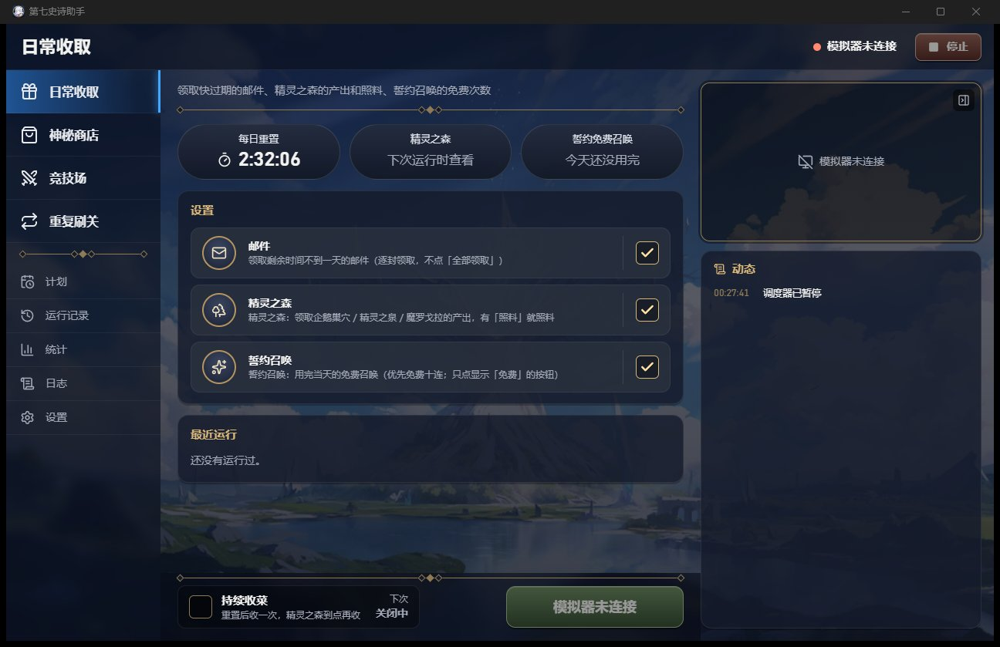
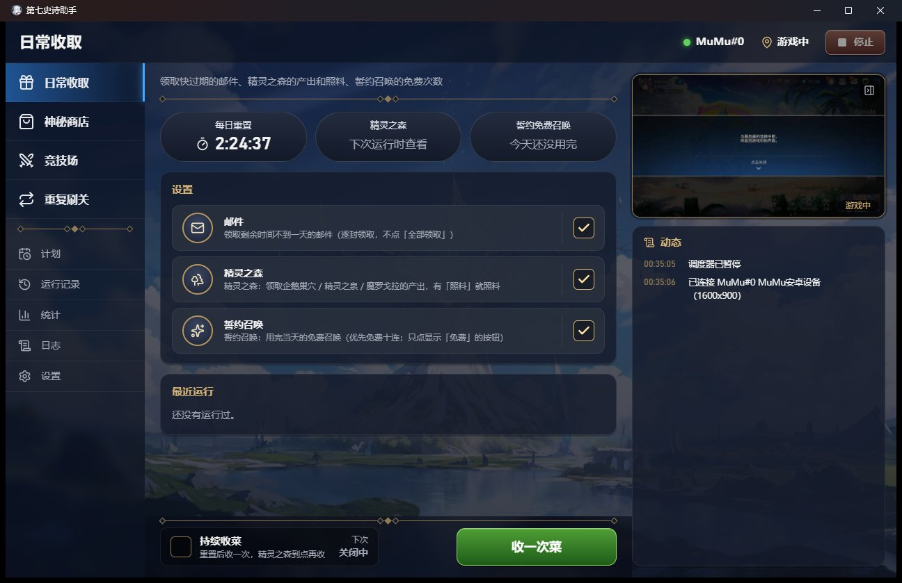

# B10 审核记录：打包发布（PyInstaller 引擎 + Tauri NSIS 安装包）

状态：✅ 已通过 · 日期：2026-10-19（同日真机验证并审核通过）

## 打包环境（开工时检查）
| 项 | 情况 |
|---|---|
| PyInstaller | 华为云镜像可装：6.22.3 + pyinstaller-hooks-contrib 2026.8，放进新的依赖组 `build`（`uv.lock` 新增 7 个包） |
| NSIS | `%LOCALAPPDATA%\tauri\NSIS` 原有 3.11 的缓存；第一次 `tauri build` 时 Tauri 认为它过期，自动从 GitHub 下载了 NSIS 3.13 和 `nsis_tauri_utils.dll` 0.5.3，速度正常 |
| WebView2 | 155（系统自带） |
| 干净环境 | Windows 沙盒没启用（`WindowsSandbox.exe` 不存在），本机只有一个用户。**用户选择只做本机模拟**（见下文验证） |

小插曲：第一次 `python -m uv pip install pyinstaller` 装进了全局 Python 3.13，没进 venv（经 `python -m uv` 调用时，uv 默认用调用它的解释器）。这 7 个包原本都不在全局环境里，我已经马上卸掉，全局环境恢复原样。CLAUDE.md 里补了一条提醒。

## 范围（和用户确认）
| 项 | 结论 |
|---|---|
| PyInstaller 形式 | onedir，作为 Tauri `bundle.resources` 放到安装目录的 `engine/` 下（onefile 每次启动要解压约 270MB，所以不用） |
| 安装范围 | **安装时让用户选**（NSIS `installMode: "both"`）。代价：安装程序以 `Highest` 权限运行，**管理员账户一启动就弹 UAC**，选「仅为我安装」也一样；标准用户不弹，只能装到当前用户 |
| 应用名 | **第七史诗助手**（窗口标题、开始菜单、卸载列表、安装包名），exe 名 `e7helper.exe` |
| 图标 | 我先画了三版 SVG 游戏风徽章（`docs/prototypes/b10/`），**用户改为用「雪之国的索尔缇娅」的头像**，并让我从网上获取 |
| opencv 的 ffmpeg DLL（30MB） | **保留**（用户选），不做任何裁剪 |
| 干净环境 | 本机模拟（用户选） |
| 默认项（用户未提异议） | 版本号 0.1.0，五处统一；不做自动更新；安装界面只有简体中文；安装包不签名 |

## 变更清单
### 引擎 `engine/`
| 文件 | 说明 |
|---|---|
| `e7helper/core/paths.py` | 新增 `FROZEN`；冻结时 `ENGINE_ROOT = sys._MEIPASS`（即 `e7engine/_internal/`），`ASSETS_DIR` 跟着变 |
| `packaging/entry.py` | 冻结入口，等同 `e7helper` 命令（`prog_name="e7engine"`，带 `freeze_support()`） |
| `packaging/e7engine.spec` | onedir；`collect_submodules("e7helper")`（模块按 pkgutil 自动发现）、`uvicorn`、`websockets`；数据：`assets/` 和 `collect_data_files("rapidocr")`（配置 + onnx 模型）；解释器选项 `-X utf8`；控制台程序，图标用 `icon.ico` |
| `packaging/build.py` | 检查 5 处版本号 → PyInstaller → 冒烟测试（`modules`、`match`、`ocr`、`serve --no-connect --paused` 的 REST / `/ws` / `/ws/frames` / shutdown；临时数据目录，不碰设备）；`--smoke` 只测、`--no-smoke` 只构建 |
| `pyproject.toml` / `uv.lock` | 新依赖组 `build = ["pyinstaller>=6.22"]` |
| `tests/test_core.py` | 新增 2 个测试：源码布局下的 `ASSETS_DIR`、冻结时用 `_MEIPASS` |

### GUI `app/`
| 文件 | 说明 |
|---|---|
| `src-tauri/src/engine.rs` | 新增 `Launch`：release 构建拉起 `<资源目录>/engine/e7engine.exe serve --port 0`，找不到时报「请重新安装」；debug 构建照旧用 venv；`E7_ENGINE_DIR` 两种构建都能覆盖成源码引擎。作业对象、`CREATE_NO_WINDOW`、`/api/shutdown` 退出流程不变 |
| `src-tauri/src/lib.rs` | 把 `app.path().resource_dir()` 传给 `connect()` |
| `src-tauri/tauri.conf.json` | `productName` 第七史诗助手、`mainBinaryName` e7helper、窗口标题、`publisher`、`shortDescription`、NSIS `installMode: both` + `SimpChinese` |
| `src-tauri/tauri.bundle.conf.json`（新） | 只在打包时合并：`bundle.resources` `../../engine/dist/e7engine/` → `engine/`。单独放是为了 `tauri dev` 不去复制、也不要求存在冻结引擎 |
| `package.json` | 新脚本 `pnpm bundle` = `tauri build --config src-tauri/tauri.bundle.conf.json` |
| `index.html`、`ConnectGate.tsx` | 「E7 Helper」改成「第七史诗助手」 |
| `src-tauri/icons/source/` | `c2111_s.png`（头像原图）、`make_icon.py`（合成）、`icon-1024.png`（母图） |
| `src-tauri/icons/*` | `pnpm tauri icon` 重新生成（新增 `64x64.png`；生成的 `android/`、`ios/` 已删除） |

### 文档
- `docs/architecture.md`：新增「打包发布（B10）」一节；GUI 一节的引擎连接补了打包版；「新增一个模块」注明冻结版不支持 entry-point 模块。
- `CLAUDE.md`：打包命令；`uv pip install` 要加 `--python`。
- `docs/prototypes/b10/`：三版没被选中的 SVG 图标（和 b09 原型一样留档）。

## 图标
- 头像来源：先在 [epic7db](https://epic7db.com/heroes/solitaria-of-the-snow) 找到 `solitaria-of-the-snow.webp`（112×112）；又从 Fribbels 优化器的 `herodata.json` 查到英雄编号 `c2111`，最终用**官方指南站**的 `static.smilegatemegaport.com/event/live/epic7/guide/images/hero/c2111_s.png`（112×112，7.9KB）。几个来源里没找到更大的头像或立绘（fandom 返回 402，官方大图路径 403）。
- 合成：深蓝圆角底 + 金色头像框（上亮下暗）+ 头像放大裁圆。Windows 图标最大 256px，头像在里面约 190px，放大约 1.7 倍，看得出略软，但能认。`icon.ico` 含 16 / 24 / 32 / 48 / 64 / 256。
- 版权提醒（已告知用户）：这是游戏官方美术，自己用没问题；公开分发安装包可能有版权风险。


## 验证
### 命令
```
cd engine
python -m uv run pytest                                          # 707 passed, 7 skipped（14 分 27 秒）
python -m uv run --group build python packaging/build.py         # 构建 + 冒烟测试
cd ../app
pnpm test                                                        # 8 passed
pnpm typecheck                                                   # 通过
cargo check / cargo check --release（src-tauri 下）               # 通过，无警告
pnpm bundle                                                      # 安装包
```

### 引擎冒烟测试（`build.py` 实测输出）
```
版本号 0.1.0（5 处一致）
PyInstaller 完成：67 秒
产物 ...\engine\dist\e7engine：272 MB，352 个文件
[ok] modules：5 个模块都在
[ok] 模板匹配；OCR 模型加载并识别出 43 条文字
[ok] serve 就绪：1.7 秒
[ok] REST：modules / status / config_schema
[ok] WebSocket：/ws hello、/ws/frames 未连接状态
[ok] /api/shutdown：正常退出（0），api.json 已删除
冒烟测试通过
```
产物里最大的几项：cv2 112MB（含 ffmpeg DLL 30MB）、onnxruntime 38MB、rapidocr 31MB、numpy + numpy.libs 27MB。

### 安装包
- `app/src-tauri/target/release/bundle/nsis/第七史诗助手_0.1.0_x64-setup.exe`：**96.43 MiB**。
- 用户手动安装（同意了 UAC），选「仅为我安装」、默认目录：
  - 安装目录 `C:\Users\jiyan\AppData\Local\Programs\第七史诗助手`（`e7helper.exe`、`engine/`、`uninstall.exe`，共 270MB）；
  - 卸载项在 HKCU：显示名「第七史诗助手」、版本 0.1.0、发布者 e7helper、图标取自 e7helper.exe；
  - 开始菜单 `第七史诗助手.lnk`，没有桌面快捷方式。

### 本机模拟干净环境（scratchpad 里的 `verify_installed.py`）
做法：只保留 Windows 必需的环境变量；PATH 只有 `System32;Windows;Wbem`（没有 Python / Node / uv / cargo）；`E7_DATA_DIR` 用全新的临时目录（没有 api.json，应用必须自己拉起引擎）；`E7_ENGINE_ARGS="--no-connect --paused"`，不连模拟器。
| 检查 | release 构建（`target/release`） | 安装版 |
|---|---|---|
| 应用自己拉起随包引擎 | 6.8 秒 | **2.7 秒** |
| 引擎进程路径 | `target\release\engine\e7engine.exe` | `...\Programs\第七史诗助手\engine\e7engine.exe` |
| `/api/status` | 设备未连接、调度暂停 | 同左 |
| 窗口 | 「第七史诗助手」，新图标 | 同左 |
| 关闭窗口 | 1.5 秒内应用和引擎都退出，api.json 删除 | 1.4 秒，同左 |
| `engine-stdout.log` | UTF-8（修复前是 GBK，见问题 1） | — |
- 中文安装路径下单独跑 `e7engine.exe ocr -f secret_shop.png` → 43 条，1277ms；`match secret_shop title` → 1.000 命中。onnxruntime 和模板读取都不受中文路径影响。
- 截图（安装版，不连模拟器）：标题栏图标和名称正确；显示「模拟器未连接」；菜单里**没有**模板采集、示例模块，没有演练条（开发者功能都隐藏了）。



### 安装版连 MuMu（用户同意：只看连接、实时画面、当前画面识别，不点任何开始按钮）
做法：同样是精简环境 + 全新的临时数据目录（没有任何计划），`E7_ENGINE_ARGS="--paused"`，只去掉 `--no-connect`；全程只调用了只读接口（`GET /api/device`、`/api/scene`、`/api/device/screenshot`），没有点击游戏。
| 检查 | 结果 |
|---|---|
| 拉起引擎 | 2.4 秒（安装目录里的 `e7engine.exe`） |
| 自动连接 | 1 秒内连上：`MuMu#0 MuMu安卓设备`，IPC 后端，1600×900（精简 PATH 下也能从注册表找到 MuMu 和 IPC DLL） |
| 顶栏 / 动态 | 「MuMu#0 · 游戏中」；动态里有「已连接 MuMu#0 MuMu安卓设备（1600x900）」 |
| 实时画面 | 右侧画面正常刷新，「收一次菜」按钮可用（**没有点**） |
| 当前画面识别 | `GET /api/scene` 45ms。游戏当时停在大厅上的「与服务器的连接中断，将返回游戏初始界面。点击关闭」框上，识别结果是「未知、无弹窗」。同一张原图交给源码版 `e7helper scene -f` 结果相同（43ms 对 47ms），**是没登记过的弹窗，跟打包无关**（见已知问题 8）。我没有点这个框 |
| 关闭 | 1.0 秒内应用和引擎都退出，api.json 删除；没有 `tasks.jsonl`（没跑过任务）；引擎日志里只有连接和关闭两条 |



### 没做的
- **卸载**：没测，需要用户来点（会弹 UAC）。
- 真正干净的机器 / 沙盒：用户选了本机模拟，所以「系统里从没装过 VC 运行库 / WebView2」这种情况没覆盖到。VC 运行库已随包带上；WebView2 在 Win10 21H2+ / Win11 上系统自带，Tauri 默认的 `downloadBootstrapper` 会在缺失时联网安装。

## 实现中遇到的问题
1. **冻结版忽略 `PYTHON*` 环境变量**（PyInstaller 的隔离配置）：`PYTHONIOENCODING=utf-8` 不起作用，输出（包括 GUI 拉起时的 `engine-stdout.log`）是 GBK。改成在 spec 里给解释器加 `-X utf8`（第一次写成了 `X utf8_mode=1`，无效，正确的写法是 `X utf8`）。UTF-8 模式会改变 `open()` 和子进程文本的默认编码，我查过引擎：所有文件读写都显式写了 `encoding="utf-8"`，adb / MuMuManager 的输出按字节显式 `decode("utf-8")`，所以只影响 stdout，正是要的效果。
2. `ASSETS_DIR` 原来按 `__file__` 往上两级算，冻结后碰巧落在 `_internal/assets`，所以能用；现在明确改成 `sys._MEIPASS`，不再依赖这个巧合。

## 已知问题 / 注意
1. **管理员账户安装必弹 UAC**（`installMode: both` 的代价）。如果希望普通玩家装起来不弹窗，可以改成 `currentUser`（只装到当前用户，不需要管理员）。
2. **安装包没签名**：下载后运行会被 SmartScreen 提示「未知发布者」；PyInstaller 的启动器偶尔会被杀毒软件误报。
3. **打包版连接已有引擎时不检查版本**：如果 `%LOCALAPPDATA%\e7helper\api.json` 指向一个还活着的旧引擎（例如开发时手动 `serve` 的），打包版会直接连它。
4. **开发版和打包版共用数据目录**（B09 已知），开发版建的演练计划到了打包版还是演练。
5. 开发版功能（`VITE_E7_DEV=1` 构建）的模板采集在打包版里会写进安装目录；装到 Program Files 时没有写权限。
6. 冻结版不支持 entry-point 外部模块（已写进文档）。
7. 图标头像只有 112px 原图，256px 尺寸略软。
8. **「与服务器的连接中断，将返回游戏初始界面」弹窗没有登记**（真机验证时发现，B10 范围外）：它盖在大厅上，场景判定为「未知」，内置弹窗规则也不认，任务启动后会认不出大厅。点「点击关闭」会回到游戏标题画面，需要重新进游戏，按 B03 的约定（登录由用户自己处理），可能应该让任务停下并提示用户，而不是自动关闭。建议后续单独处理。
9. 审核时 `docs/HANDOFF.md` 还没更新（按工作流在审核通过后更新）。

## 待用户决定
- ~~打包版的真机验证~~：用户同意「只看连接、实时画面和当前画面识别」，已完成（见上文）。
- **卸载测试**：由你在「设置 → 应用」或开始菜单里卸载一次，我再检查文件和注册表有没有清干净（数据目录 `%LOCALAPPDATA%\e7helper` 应该保留）。
- 安装模式是保留 `both`（弹 UAC），还是改成 `currentUser`。

## 用户意见
- 真机验证：同意「用安装版连 MuMu，只看连接、实时画面和当前画面识别，不点任何开始按钮」，已按此完成。
- 审核意见：「没有完成模板采集，用户自己设定流程运行的功能」。确认后的处理：
  - **B10 按打包审核通过**；
  - 新开 **B11「自定义流程 + 玩家模板采集」**（原 B11+ 顺延为 B12+）；
  - 流程做到「**步骤 + 条件分支**」（步骤列表，加「如果出现模板 A 就…否则…」和「循环到某模板出现为止」）；
  - 模板采集开放「**玩家版**」：正式版里有简化的采集页，模板存到用户数据目录，只给自定义流程用，内置模块的模板不让改。
- 安装模式（`both`，管理员账户会弹 UAC）和卸载测试，用户没有另提意见：安装模式保持现状，卸载没有测。
- 真机验证中发现的「与服务器的连接中断」弹窗，由用户启动的单独会话处理（不属于 B10）。
