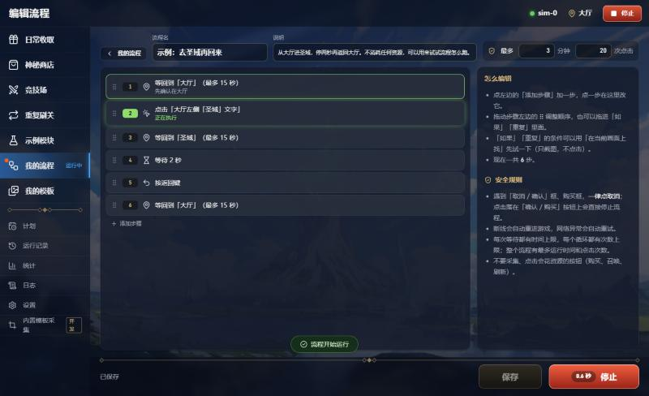
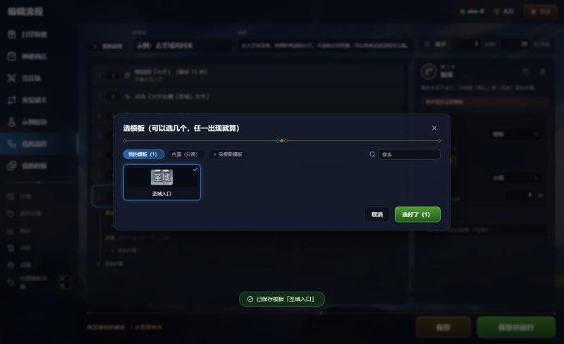
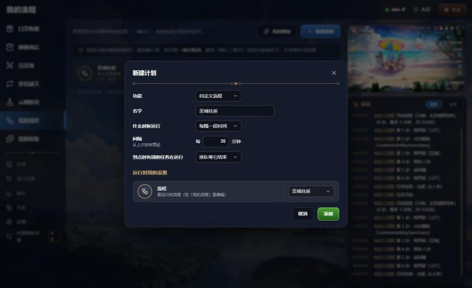
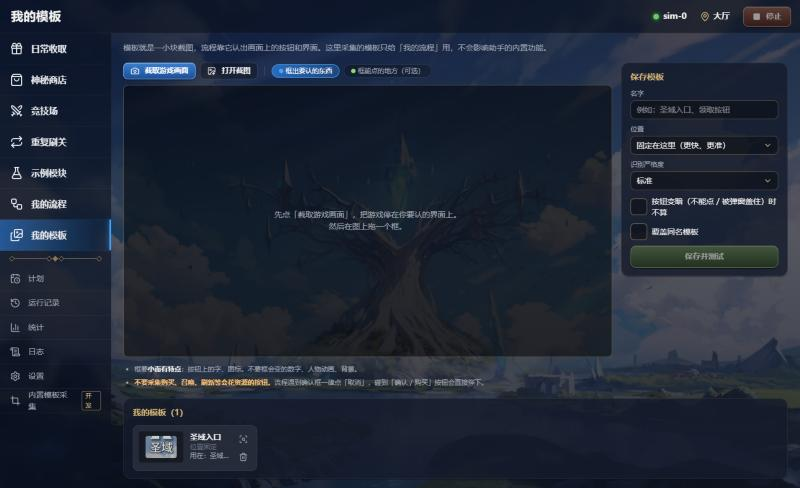
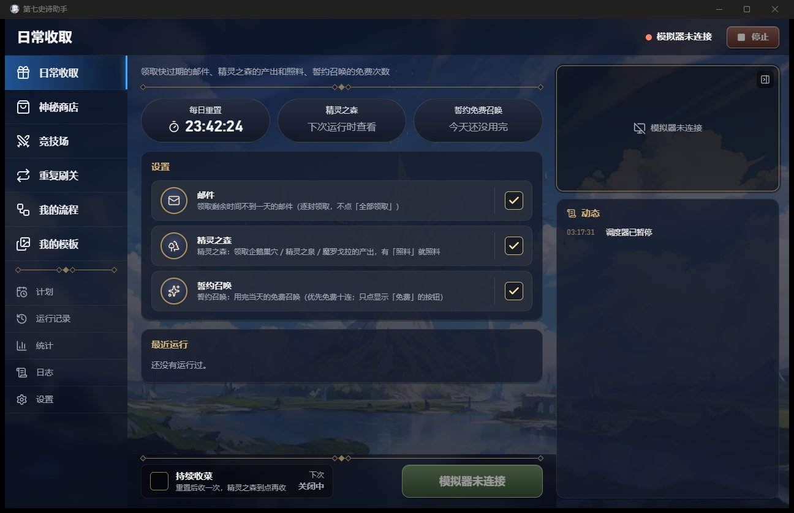
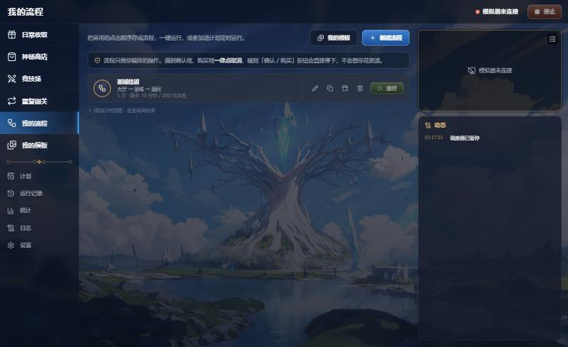
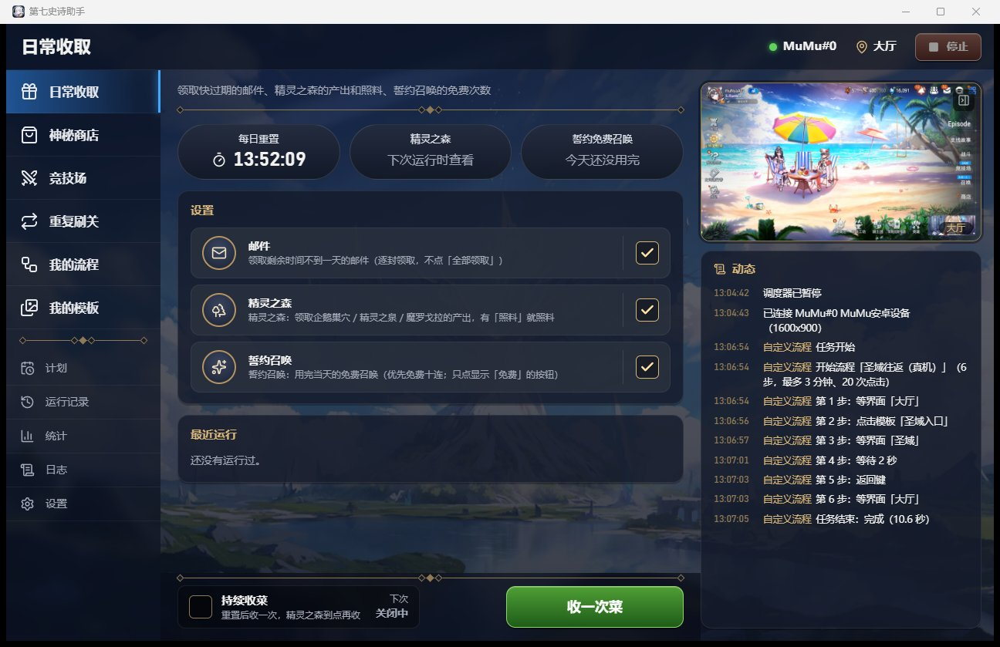

# B11 审核记录：自定义流程 + 玩家模板采集

状态：✅ 已通过 · 日期：2026-10-19（同日真机验证并审核通过）

## 范围（和用户确认）
| 项 | 结论 |
|---|---|
| 流程结构 | **嵌套积木**（用户选）：「如果…那么…否则…」「重复…」是可以装步骤的块，不用「跳到第 N 步」 |
| 步骤类型 | 点击模板、点击坐标、滑动、返回键、等待 N 秒、等画面静止、等模板出现 / 消失、等内置界面（大厅 / 圣域 / 商店 / 秘密商店 / 竞技场）、结束流程（成功 / 失败）、跳出循环、如果、重复（N 次 / 直到条件成立 / 条件成立时一直重复）。找模板的步骤有「找不到时：停止流程 / 跳过」 |
| 条件 | 模板（选几个，任一）出现 / 不出现，或在 / 不在某个内置界面；最多等 X 秒（0 = 只看当前画面） |
| 存储 | 流程 `<数据目录>/flows/<id>.json`；玩家模板 `<数据目录>/flows/templates/`（png + json，和内置模板同格式，所有流程共用）。流程可以**只读**引用 `common` 内置模板（不含弹窗模板）；其他内置模块的模板不开放（我提的方案，用户没有异议） |
| GUI 形式 | **「我的流程」页 + 一个通用模块 `custom_flow`**（用户选）：config 里选流程；运行、急停、计划、运行记录全部复用 |
| 确认框 | **一律点取消，禁止点确认**（用户选）：取消 / 确认框和已知的消耗框自动点取消后继续；点击落在「确认 / 购买」按钮上直接拦下并停止流程 |
| 编辑器界面 | 用户让我决定。只做了一种：左边步骤树（积木缩进，金色 = 如果、蓝色 = 重复，可拖动），右边属性面板，底部保存 / 运行 |
| 限制 | 每个流程「最多运行时间」默认 10 分钟（0.5–120）、「最多点击次数」默认 200（1–5000）；单步最多等 300 秒；循环最多 999 轮；最多嵌套 6 层、300 步（我提的方案，用户没有异议） |

## 变更清单
### 引擎 `engine/`
| 文件 | 说明 |
|---|---|
| `e7helper/core/flows/model.py`（新） | 流程定义（pydantic）：`Flow`、12 种步骤（`type` 区分的联合类型）、`Condition`、`FlowLimits`；结构校验（嵌套层数、步数、`break` 只能在循环里、不能点 `common:dialog/confirm`、坐标在 1600×900 内） |
| `e7helper/core/flows/store.py`（新） | `FlowStore`（id 由服务端分配，原子写入，读不了的文件单独列出）；玩家模板库；`flow_vision()`；`missing_templates()` |
| `e7helper/modules/custom_flow/`（新） | `CustomFlow` 模块（加载、限时、统计）、`runner.py` 执行器、`guard.py` 安全规则 |
| `e7helper/api/flows.py`（新） | `/api/flows` CRUD + 复制、删除保护；`/api/user-templates` 列表 / 图片 / 保存并回验 / 删除保护 / 在画面上测试 |
| `e7helper/api/capture.py`、`app.py` | 回验逻辑拆成 `verify_template()`；冻结画面 `FrameCache` 在 `create_app` 里建一个，开发版采集和玩家版共用 |
| `e7helper/modules/base.py` | 契约新增 `Module.make_vision()`（默认 本模块 → common），`custom_flow` 改成只查玩家模板 |
| `e7helper/core/runtime/runner.py` | 任务和助手的识别器改用 `cls.make_vision()`；新增捕获 `TaskFailed`（只记消息，不带调用栈） |
| `e7helper/core/runtime/errors.py`、`__init__.py` | 新增 `TaskFailed` |
| `e7helper/core/runtime/controller.py` | `dismiss_popups(only=...)`：只关闭指定的弹窗，遇到别的弹窗或遮罩直接返回 |
| `e7helper/core/paths.py` | `flows_dir()`、`user_templates_dir()` |
| `packaging/build.py` | 冒烟测试加上 `custom_flow`，并检查玩家模板存进数据目录（不在安装目录）、流程能新建 / 列出 |
| `tests/test_custom_flow.py`（新，41 个） | 定义、存储、执行（分支 / 循环 / 结束 / 跳过）、安全（确认框、拦截、点击上限、运行时间、急停、断线重进、不碰遮罩）、事件、日志 |
| `tests/test_flows_api.py`（新，9 个） | 接口：鉴权、CRUD、校验、模板保存 / 列表 / 测试 / 删除保护、内置模板只读、经 `/api/tasks` 跑流程、删除被计划使用的流程 |
| `tests/test_scene.py` | 「所有模块注册弹窗后断线画面仍认对」的测试给假模块补上 `config`（`custom_flow` 没选流程时 setup 会报错，但守卫弹窗已先注册） |

### GUI `app/`
| 文件 | 说明 |
|---|---|
| `src/lib/flow.ts`（新）+ `flow.test.ts`（8 个） | 数据形状、步骤树操作（按 id 定位、插入 / 删除 / 移动 / 复制，不能拖进自己里面）、编号（和引擎日志一致）、中文描述、本地检查、校验错误定位到步骤、pydantic 英文信息转中文 |
| `src/lib/flowHooks.ts`（新） | `useFlows`、`useTemplates`（内置模板用备注括号前那段当名字）、`useFlowNames` |
| `src/components/flow/`（新） | `StepTree`（积木、拖放、上移 / 下移 / 复制 / 删除、添加步骤菜单、正在执行高亮）、`StepPanel`（各类步骤的属性、条件编辑、「在当前画面上找」）、`Pickers`（模板选择：我的 / 内置 / 现场采集；坐标点选 / 滑动线）、`TemplateCapture`（玩家版采集）、`FrameCanvas` |
| `src/pages/FlowsPage.tsx`、`FlowEditorPage.tsx`、`TemplatesPage.tsx`（新） | 我的流程、编辑流程、我的模板 |
| `src/modules/custom_flow/index.tsx`（新） | 模块界面：不在菜单单独出现（`menuHidden`），统计项中文名 |
| `App.tsx`、`SideMenu.tsx`、`TopBar.tsx` | 路由 `/flows`、`/flows/:id`、`/templates`；菜单加「我的流程」「我的模板」（正式版也有）；开发版采集页改叫「内置模板采集」；`/m/custom_flow` 跳到 `/flows`；编辑器和我的模板页不显示右侧栏 |
| `pages/SchedulesPage.tsx` | `ScheduleEditor` 导出，支持预填（「加入计划」） |
| `pages/HistoryPage.tsx` | 自定义流程显示成「流程「名字」」 |
| `lib/schema.ts`、`ConfigForm.tsx`、`types.ts` | 枚举支持显示名（`x-enum-labels`），计划里的流程字段是下拉框 |
| `lib/api.ts`、`query.ts`、`store.ts`、`modules/registry.ts`、`modules/types.ts` | 新接口、查询键、`custom_flow.step` 事件（`flowStep`）、`menuModules` / `menuHidden` |

### 文档
- `docs/architecture.md`：模块契约 `make_vision`；运行时 `TaskFailed`、`dismiss_popups(only=)`；API「自定义流程和玩家模板接口」；GUI「自定义流程」；打包（玩家模板在数据目录）；已有模块 `custom_flow`。

## 安全规则（实现）
1. 流程运行时**只**自动处理：断线重进（`disconnected` / `announcement` / `title_start`）、网络重试（`network`）、守卫弹窗（排在所有模块弹窗前面判定，一律点取消）：
   - 秘密商店购买框、竞技场补旗框、行动力不足 / 购买框、是否开始托管战斗、通用「取消 / 确认」框（结束游戏、天空石立即更新等）。
   - 其他弹窗、遮罩都不碰（遮罩兜底的返回键在流程里不生效），免得打断玩家自己的流程（例如玩家要点的奖励框）。
2. 每次点击 / 滑动前，在当前画面上找已知的「确认 / 购买」按钮：确认框「确认」、秘密商店「购买」、竞技场补旗「购买」、行动力「购买」、召唤结果「再召唤一次」。落点碰到就拦下，流程失败，统计记 `blocked`。
3. 流程不能选 `common:dialog/confirm` 当点击目标（保存时就拒绝）。
4. 每个等待都有超时、每个循环都有次数上限；流程有最多运行时间（到点按超时停止）和最多点击次数。

## 验证
### 命令
```
cd engine
python -m uv run pytest                                          # 780 passed, 7 skipped（13 分 20 秒）
python -m uv run pytest tests/test_custom_flow.py tests/test_flows_api.py   # 50 passed
python -m uv run --group build python packaging/build.py         # 构建 + 冒烟测试
cd ../app
pnpm test                                                        # 16 passed（新增 flow.test.ts 8 个）
pnpm typecheck                                                   # 通过
pnpm bundle                                                      # 安装包
```

### 离线测试覆盖（`tests/test_custom_flow.py`，GameSim 用 fixtures 截图模拟游戏）
| 场景 | 结果 |
|---|---|
| 大厅 → 点 `common:lobby/sanctuary` → 等圣域 → 返回 → 等大厅 | 成功，1 次点击、1 次返回键，`history.jsonl` / `stats.json` 正确 |
| 如果（玩家模板「圣域标题」）出现 → 那么 / 否则 | 在圣域走「那么」（返回键），在大厅走「否则」（点坐标） |
| 条件「不出现」、条件等待 | 正确 |
| 重复直到在大厅（从圣域说明弹窗开始） | 按 2 次返回键后停 |
| 重复直到跑满 | `on_limit=stop` 失败（错误只有一句话，不带调用栈，保存了调试信息）；`continue` 接着往下 |
| 重复 N 次 + 如果里「跳出循环」 | 点 1 次就跳出 |
| 当…时一直重复（while） | 正确 |
| 结束流程（失败 / 成功） | 后面的步骤不执行 |
| 找不到模板：停止 / 跳过 | 正确 |
| 等模板消失、滑动、等画面静止 | 正确 |
| 大厅按返回键 → 结束游戏确认框 | 下一步之前自动点取消，**没进 DANGER** |
| 确认框开着时点「确认」按钮的坐标 | 先点取消关掉框，确认没被点到 |
| 落点在确认按钮上（守卫检查） | 拦下（`FlowBlocked`）；取消按钮可以点 |
| 最多点击次数 3 | 第 4 次之前停止，失败 |
| 最多运行时间 | 按超时停止，0.6 秒内退出 |
| 急停 | `stopped` |
| 断线重进（从断线画面开始） | 自动重进后接着跑完 |
| 遮罩（圣域说明弹窗） | 流程里不按返回键兜底 |
| 启动前检查 | 没选流程 / 流程不存在 / 没有步骤 / 缺模板 → 启动就报错 |

### GUI（开发版，浏览器面板 + 用 GameSim 当设备的临时引擎，不碰真机）
- 「添加示例：去圣域再回来」→ 打开编辑器 → 运行：6.1 秒完成；运行中高亮正在执行的步骤（第 2 步「正在执行」）、底部变「停止」、菜单「我的流程 · 运行中」。
- 添加「如果」积木 → 选模板 → 在选择框里「采集新模板」：截模拟器画面、框出大厅「圣域」、起名「圣域入口」，保存后自动选中；「在当前画面上找」：找到了 1.00。
- 拖动：把「按返回键」拖进「那么」分支，编号变成 6.1（浏览器面板的模拟鼠标拖不动原生拖放，用脚本派发 dragstart / dragover / drop 验证）。
- 校验：顶层放「跳出循环」，卡片标红「只能放在循环里」；保存被引擎拒绝（422），提示「没有保存：「跳出循环」只能放在循环里」。
- 有未保存的修改时点菜单离开 → 弹「有没保存的修改」确认框。
- 流程列表「加入计划」→ 计划编辑框预填「自定义流程」，流程字段是下拉框（显示流程名）。运行记录显示「流程「圣域往返」」。






### 打包
- 引擎冒烟测试：
  ```
  版本号 0.1.0（5 处一致）
  PyInstaller 完成：63 秒
  产物 ...\engine\dist\e7engine：272 MB，362 个文件
  [ok] modules：6 个模块都在
  [ok] 模板匹配；OCR 模型加载并识别出 43 条文字
  [ok] serve 就绪：1.2 秒
  [ok] REST：modules / status / config_schema
  [ok] 自定义流程：玩家模板存进数据目录，流程可以新建 / 列出
  [ok] WebSocket：/ws hello、/ws/frames 未连接状态
  [ok] /api/shutdown：正常退出（0），api.json 已删除
  冒烟测试通过
  ```
- 安装包：`app/src-tauri/target/release/bundle/nsis/第七史诗助手_0.1.0_x64-setup.exe`，**96.49 MiB**（B10 是 96.43）。这个 worktree 第一次编译 Rust，`pnpm bundle` 约 9 分钟。

### 本机模拟干净环境（同 B10：scratchpad 的 `verify_installed.py`）
做法：只保留 Windows 必需的环境变量，PATH 只有 `System32;Windows;Wbem`；`E7_DATA_DIR` 是全新的临时目录；`E7_ENGINE_ARGS="--no-connect --paused"`，不连模拟器。跑的是 release 构建 `target/release/e7helper.exe`（安装要 UAC，没装）。
| 检查 | 结果 |
|---|---|
| 应用自己拉起随包引擎 | 3.8 秒，进程是 `target\release\engine\e7engine.exe` |
| `/api/status` | 设备未连接、调度暂停 |
| 模块 | 6 个，含 `custom_flow` |
| 玩家模板（上传 `lobby.png` 后框选保存） | `quality = good`，原位置 1.00；**文件在数据目录 `flows/templates/`，安装目录里没有** |
| 流程 | 新建「圣域往返」（5 步），`flows/<id>.json` |
| 没连模拟器时运行流程 | 503「设备未连接」 |
| 正式版界面 | 菜单有「我的流程」「我的模板」，没有示例模块、内置模板采集、演练条；流程列表显示刚建的流程，「运行」是灰的（模拟器未连接）——见下图（`vite preview` 打开同一份正式版前端，连这个引擎） |
| 关闭窗口（WM_CLOSE） | 0.4 秒内应用和引擎都退出，api.json 删除 |




### 真机验证（用户同意：正式版采一个圣域入口模板，跑 大厅 → 圣域 → 返回，不点任何消耗资源的按钮）
做法：release 构建 `target/release/e7helper.exe`，同上的精简环境 + 全新数据目录，`E7_ENGINE_ARGS="--paused"`（连 MuMu、调度暂停）。界面操作在浏览器面板里用 `vite preview` 打开同一份正式版前端（连同一个引擎），Tauri 窗口靠 WS 同步显示，最后用 PrintWindow 截图对照。
| 步骤 | 结果 |
|---|---|
| 拉起 | 7.4 秒，IPC 连上 `MuMu#0 MuMu安卓设备`（1600×900） |
| 我的模板 → 截取游戏画面 | 只读截图，游戏停在大厅 |
| 框选 | 要认的东西 (44, 241, 51, 35)「圣域」文字，能点的地方 (40, 195, 62, 81) 图标连文字（和内置模板同一处）；起名「圣域入口」 |
| 保存并测试 | 「认得很清楚」：原位置 1.00，画面上别处最高 0.20；文件在数据目录 `flows/templates/圣域入口.png` |
| 建流程 | 「添加示例」后把第 2 步换成「圣域入口」，改名「圣域往返（真机）」：等大厅 → 点击「圣域入口」→ 等圣域 → 等 2 秒 → 返回键 → 等大厅；上限 3 分钟 / 20 次点击 |
| 运行前 | `GET /api/scene`：大厅，无弹窗 |
| 运行（点编辑器的「运行」） | **成功，10.6 秒**；编辑器依次高亮第 1 → 6 步；1 次点击、1 次返回键、0 个弹窗；结束时在大厅、无弹窗 |
| 记录 | `/api/tasks/history`：succeeded，config `{"flow": "f1afbb40"}`；`custom_flow/stats.json`：runs 1、succeeded 1、taps 1、blocked 0；流程列表「上次 完成（刚刚）」 |
| 关闭窗口（WM_CLOSE） | 0.9 秒内应用和引擎都退出，api.json 删除 |

日志（引擎 `/api/logs`）：
```
13:04:43 已连接 MuMu#0 MuMu安卓设备（1600x900）
13:06:54 开始流程「圣域往返（真机）」（6 步，最多 3 分钟、20 次点击）
13:06:54 第 1 步：等界面「大厅」
13:06:56 第 2 步：点击模板「圣域入口」
13:06:57 第 3 步：等界面「圣域」
13:07:01 第 4 步：等待 2 秒
13:07:03 第 5 步：返回键
13:07:03 第 6 步：等界面「大厅」
13:07:05 任务结束：succeeded（10.6 秒）
```
全程只点了大厅的「圣域」入口和一次返回键，**没有点任何购买、召唤、刷新、领取按钮**。验证用的数据目录是临时目录，没碰真实的 `%LOCALAPPDATA%\e7helper`。



## 实现中遇到的问题
1. 全量测试里有个测试会对所有模块调 `setup()`（用假对象，没有 `config`）。`custom_flow` 的 setup 要读配置 → 改成先注册守卫弹窗、再检查配置，测试的假对象补上契约本来保证有的 `config`。
2. 编辑器里「添加步骤」后新步骤没被选中：弹出菜单是 Portal，但 React 合成事件照样冒泡到外层「点空白取消选择」。改成只在直接点面板空白时取消。
3. 引擎日志里模板显示成 `common:lobby/sanctuary`，玩家看不懂 → 日志和错误信息改用玩家模板名 / 内置模板备注（「点击模板「大厅左侧「圣域」文字」」）。

## 已知问题 / 注意
1. **玩家自己采集的「购买 / 召唤」按钮拦不住**：拦截清单只有内置模块认识的按钮。靠采集页和编辑器的提示「不要采集会花资源的按钮」+ 确认框一律点取消兜底。
2. 「等界面」只能选助手认识的 5 个界面；别的界面用「等模板」。
3. 流程运行中改了流程并保存，不影响这次运行（启动时已加载），下次运行用新的。
4. 删除玩家模板时如果有流程在用，GUI 先提示用在哪些流程再删；删了之后这些流程显示「缺少模板」，不能运行。
5. 流程不能导入 / 导出、不能调用别的流程（没做）。
6. 浏览器面板的模拟鼠标触发不了原生拖放，所以拖动只用脚本派发事件验证过；真实鼠标在 WebView2 里应该没问题，审核时可以顺手拖一下。

## 用户意见
- 2026-10-19：审核通过，没有修改意见。
